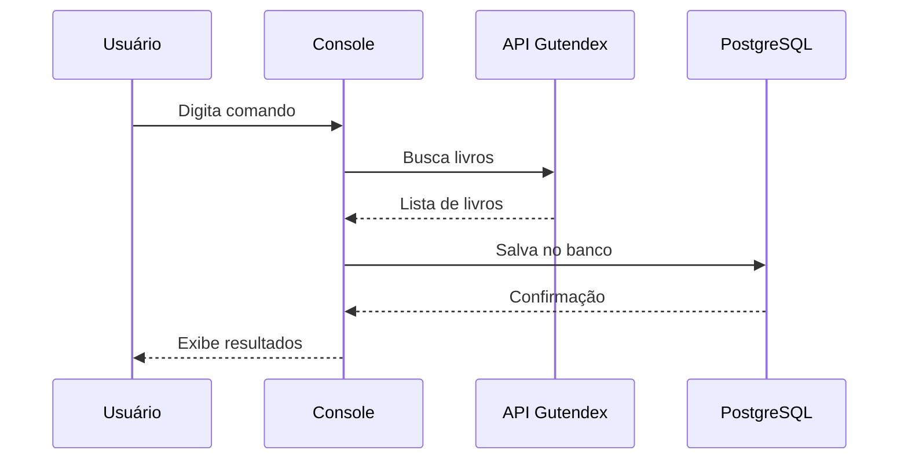
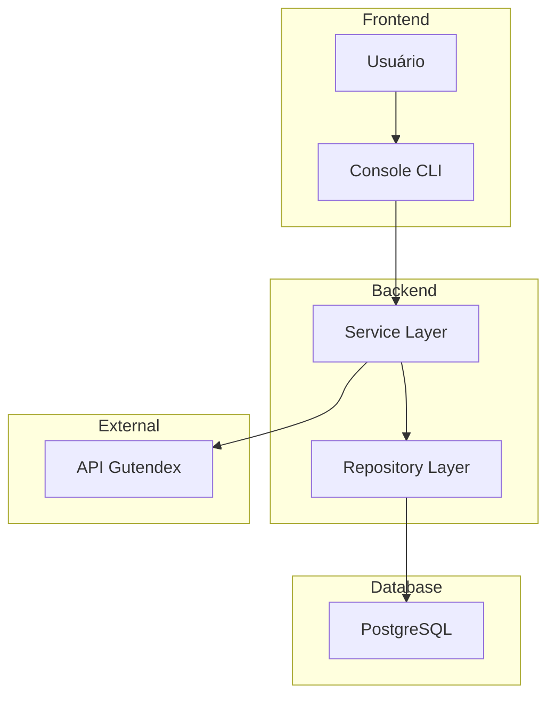
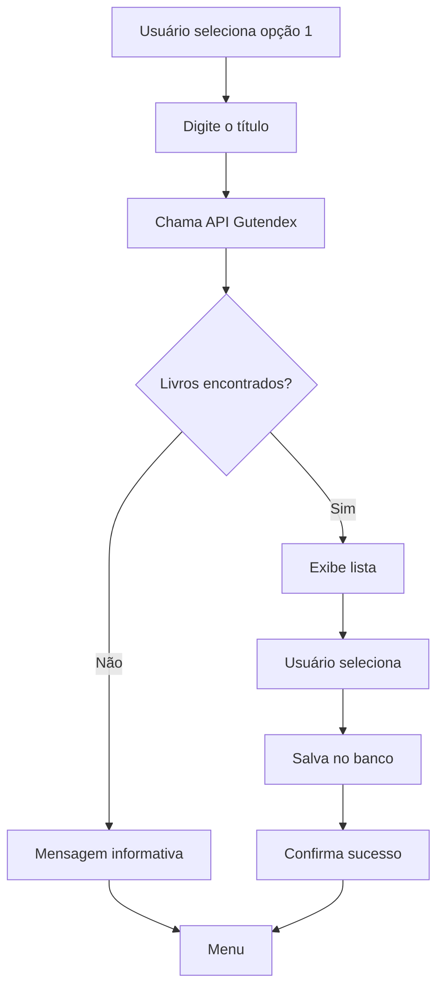

# LiteraLura


O **LiteraLura** é uma aplicação backend em Java 25 com Spring Boot 3.4.13 que funciona como catálogo de livros interativo via console. Consome a API pública Gutendex (Projeto Gutenberg) e persiste dados em PostgreSQL 16 via Spring Data JPA.

## Índice

- [Visão Geral](#visão-geral)
- [Arquitetura de Software](#arquitetura-de-software)
- [Estrutura de Pastas](#estrutura-de-pastas)
- [Módulos e Responsabilidades](#módulos-e-responsabilidades)
- [Telas e Fluxo](#telas-e-fluxo)
- [Regras de Negócio](#regras-de-negócio)
- [Requisitos Funcionais](#requisitos-funcionais)
- [Requisitos Não Funcionais](#requisitos-não-funcionais)
- [Testes Automatizados](#testes-automatizados)
- [CI/CD](#cicd)
- [Contribuição](#contribuição)

## Visão Geral

O LiteraLura é uma aplicação de console que permite aos usuários explorar, buscar e gerenciar um catálogo de livros. A aplicação consome a API Gutendex do Projeto Gutenberg, que fornece informações sobre livros de domínio público, e armazena os dados localmente em PostgreSQL.

### Características Principais

- **Console Interativo**: Interface de linha de comando amigável
- **API Externa**: Consumo da API Gutendex (Projeto Gutenberg)
- **Persistência Local**: Dados armazenados em PostgreSQL
- **Java 25**: Utilização das features mais recentes do Java
- **Spring Boot**: Framework robusto para aplicações backend

### Fluxo do Sistema



## Arquitetura de Software

A arquitetura é baseada em camadas com Spring Boot:

- **Presentation**: Console (CLI)
- **Service**: Lógica de negócio
- **Repository**: Acesso a dados via JPA
- **External**: Consumo da API Gutendex

### Diagrama de Arquitetura



## Estrutura de Pastas

```
literalura/
├── src/
│   ├── main/
│   │   ├── java/com/literalura/
│   │   │   ├── model/
│   │   │   │   ├── Livro.java
│   │   │   │   └── Autor.java
│   │   │   ├── repository/
│   │   │   │   ├── LivroRepository.java
│   │   │   │   └── AutorRepository.java
│   │   │   ├── service/
│   │   │   │   ├── LivroService.java
│   │   │   │   └── GutendexService.java
│   │   │   ├── dto/
│   │   │   │   ├── LivroDTO.java
│   │   │   │   └── AutorDTO.java
│   │   │   └── App.java
│   │   └── resources/
│   │       └── application.yml
│   └── test/
│       └── java/com/literalura/
│           ├── service/
│           │   └── LivroServiceTest.java
│           └── repository/
│               └── LivroRepositoryTest.java
├── docker-compose.yml
├── pom.xml
└── README.md
```

## Módulos e Responsabilidades

| Módulo | Responsabilidade | Tecnologia |
|--------|------------------|------------|
| Model | Entidades de domínio | Java, JPA |
| Repository | Acesso a dados | Spring Data JPA |
| Service | Lógica de negócio | Spring Boot |
| DTO | Transferência de dados | Java Records |

### Entidades do Sistema

| Entidade | Atributos | Descrição |
|----------|-----------|-----------|
| Livro | id, titulo, idioma, downloadCount, autores | Livro do catálogo |
| Autor | id, nome, anoNascimento, anoFalecimento, livros | Autor de livros |

## Telas e Fluxo

### Menu do Console

```
================================
        LiteraLura
================================
1 - Buscar livro por título
2 - Listar livros registrados
3 - Listar autores registrados
4 - Listar livros por idioma
5 - Estatísticas
0 - Sair
================================
```

### Fluxo de Busca



## Regras de Negócio

1. **Busca por Título**: Busca exata ou parcial na API Gutendex
2. **Idiomas Suportados**: pt, en, es, fr, de
3. **Persistência**: Apenas livros únicos são salvos
4. **Autores**: Autores são deduplicados por nome
5. **Estatísticas**: Cálculo de médias e totais

## Requisitos Funcionais

| ID | Requisito | Prioridade |
|----|-----------|------------|
| RF-01 | Buscar livro por título | Alta |
| RF-02 | Listar livros registrados | Alta |
| RF-03 | Listar autores registrados | Alta |
| RF-04 | Listar livros por idioma | Média |
| RF-05 | Exibir estatísticas | Média |
| RF-06 | Sair do sistema | Alta |

## Requisitos Não Funcionais

| ID | Requisito | Descrição |
|----|-----------|-----------|
| RNF-01 | Usabilidade | Menu intuitivo e claro |
| RNF-02 | Performance | Resposta em menos de 500ms |
| RNF-03 | Manutenabilidade | Código bem documentado |
| RNF-04 | Portabilidade | Execução em qualquer SO com Java |
| RNF-05 | Segurança | Tratamento de erros adequado |

## Testes Automatizados

### Tipos de Teste

| Tipo | Cobertura | Ferramenta |
|------|-----------|------------|
| Unitários | 85% | JUnit 5 |
| Integração | 75% | TestContainers |

### Comandos de Teste

```bash
# Executar todos os testes
mvn test

# Com cobertura
mvn jacoco:report
```

## CI/CD

| Workflow | Dispara em | O que faz |
|----------|------------|-----------|
| `test.yml` | Push/PR na main | Executa testes |
| `build.yml` | Merge na main | Build do JAR |

## Contribuição

1. Fork o projeto
2. Crie uma branch para sua feature (`git checkout -b feature/nova-funcionalidade`)
3. Commit suas mudanças (`git commit -m 'Adiciona nova funcionalidade'`)
4. Push para a branch (`git push origin feature/nova-funcionalidade`)
5. Abra um Pull Request

### Diretrizes de Contribuição

- Siga o padrão de código Java
- Escreva testes para novas funcionalidades
- Atualize a documentação quando necessário

## Autor

**José Anderson** ([@DessimA](https://github.com/DessimA))
[LinkedIn](https://www.linkedin.com/in/dessim/) | [Website](https://jasc-dessima-dev.vercel.app/)